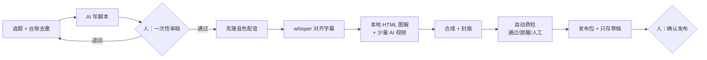

# AI 品牌短视频自动化流水线

> 一个人每天审稿半小时，机器夜里出片，大多数成片零 AI 视频积分。
> 这是我把一条真实运行的企业宣传片量产线沉淀成的方法手册 + Claude Skill。

作者：Hongshuo ｜ 首版：2026 年 11 月 ｜ 许可：CC BY-NC 4.0

---

## 解决的问题

企业要在十几个平台持续发宣传视频，传统做法是写稿、配音、剪辑、做封面全靠人，一天做不了几条，而且越做越像。我想要的是：

- **人只做判断**：审稿、看片、决定发布；其余全部自动。
- **质量先于产量**：每条一分钟左右、每镜只讲一件事、连续 5 条画面不重复。
- **成本可控**：AI 视频只用在"动起来才讲得清"的镜头上。

## 结果（上线第一周）

| 指标 | 数值 |
|---|---|
| 第一条无人值守成片 | 第 1 天跑通，69.8 秒，0 积分 |
| 单条全流程 | 本机 6–9 分钟（旧路线同类片 44 分钟 + 160 积分 + 人工点击） |
| 一晚产量 | 一批 31 条审过的稿夜跑出片 |
| 人工投入 | 每天审稿约 30 分钟 + 抽看成片 |
| 自动质检 | 对 52 条历史成片体检，分拣为通过 25 / 提醒 24 / 人工 3，问题回写到写稿与字幕规则 |
| 可复制性 | 第 4 天把方法交给另一个品牌的同事独立复制 |

## 流水线



## 七条原则

1. 人只出现在三处：审稿、看片/试听、发布授权。
2. 质量第一，产量由"审过的稿数"决定。
3. 钱只花在"动起来才讲得清"的镜头，其余本地图解、零成本。
4. 每一步可重跑、有状态；失败重试一次就挪去待人工，队列不停。
5. 一个任务一个执行者，按阶段固定归属。
6. 去重靠台账，不靠记忆。
7. 工具只存草稿，绝不替人发布。

## 我在其中的角色

这条线由我主导设计和决策，Claude 负责写稿、写代码与审核，Codex 负责本机执行。我做的是这些 AI 做不了的部分：定口径和质量标准、决定人机分工和预算、判断什么内容能带来客户咨询、在产量和质量之间取舍、把整套方法交给别人复制。**这个仓库展示的正是"用多个 AI 搭一条生产线"的能力，而不是某一个工具的用法。**

## 仓库内容

```
skill/ai-brand-video-pipeline/
  SKILL.md                 总览、原则、口径速查、交付自检
  references/              10 篇：结构、脚本、画面与预算、配音对齐、编排与质检、
                           审稿发布、多助手协作、复制到新品牌、踩坑记录、案例
  assets/templates/        品牌档案、频道档案、策划.json、任务单、协调板
  scripts/check_script.py  旁白稿自检（字数→时长、字幕句长、禁用词等）
dist/ai-brand-video-pipeline.skill   可直接安装的打包文件
```

## 怎么用

- **当手册读**：从 `skill/ai-brand-video-pipeline/SKILL.md` 开始。
- **装进 Claude**：在 claude.ai 打开 `dist/` 里的 `.skill` 文件保存；Claude Code 用户把 `skill/ai-brand-video-pipeline/` 放到 `~/.claude/skills/`。装好后直接说"帮我搭一条品牌视频自动化流水线"。
- **复制到你的品牌**：按 `references/08-复制到新品牌.md` 的清单，先跑通一条零积分样片再放量。

## 说明

本仓库不含任何公司的账号、素材、客户信息与内部代码；案例数据已脱敏。欢迎交流，转载请注明出处，不得用于商业用途。
